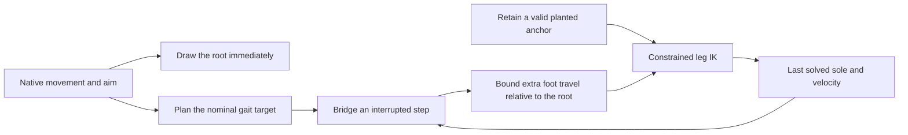
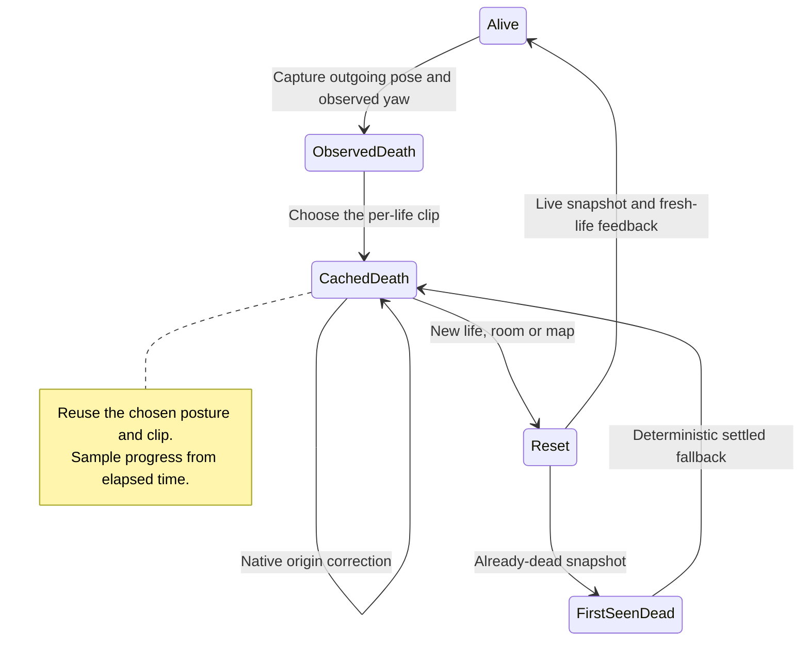
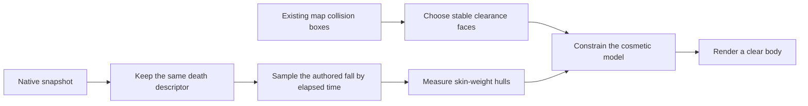
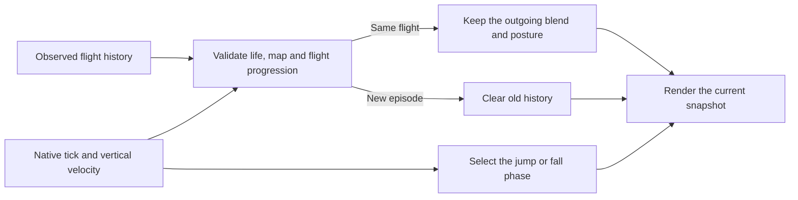

# Animation audit follow-up

The strict review of PR #2 at `9c005e1` found six remaining issues. They are
being corrected in order. A deployed build, a passing test and human acceptance
are recorded separately.

| Audit finding | Current status |
| --- | --- |
| F01: stop/restart foot discontinuity | Automated correction verified; human review and deployment pending |
| F02: reconstructed corpse changes pose | Automated correction verified; human review and deployment pending |
| F03: corpse intersects existing cover | Automated correction verified; human review and deployment pending |
| F04: airborne reconstruction restarts jump progress | Automated correction verified; human review and deployment pending |
| F05: quiet lateral walking lacks meaningful support coverage | Open |
| F06: CPU budget and sustained desktop/Android acceptance | Dedicated optimization/profiling deferred by maintainer; timing references advisory |

The audit IDs above are separate from the requirement IDs in the
[completion ledger](hybrid-animation-requirements.md).

## F01: start a redirected step from the foot that was actually drawn

Previously, stopping could replace a swinging foot's position with its neutral
standing position. Restarting reused a frozen gait phase and could immediately
select a target halfway through a swing. A retained contact also became unsafe
when a later lift returned directly to the nominal path.

The correction keeps a reachable planted anchor. An interrupted swing starts
from the outgoing solved sole and its velocity, then joins the destination with
a finite 50 ms correction. Both the position and velocity corrections reach
zero at the endpoint. A stop settles at the outgoing foot's horizontal position.
The pelvis reach calculation includes an active recovery so that the IK solver
does not immediately undo it with a different target.
An interrupted handoff can use up to 8 units of pelvis correction, compared with
the existing 7-unit steady limit. This extra reach prevents the body braking pose
from forcing a near-limit outgoing sole to a new position. Its visual quality
still needs review together with the rest of the action.



Rapid reversals shrink and redirect the planned step through a 100 ms velocity
filter. They do not flip a full stride instantly across the body. This filter
only affects foot planning; it never filters player input, root position, camera
facing, shot timing or authoritative movement.

During an interruption, additional foot travel relative to the root has a speed
budget. The actual root displacement is preserved in full. The budget allows the
nominal walking swing to overtake the root, while preventing an instantaneous
replacement with a distant target. It is our presentation tuning, not a copied
Counter-Strike threshold. Ordinary uninterrupted cycles retain their existing
target paths.

The recovery uses an analytic velocity. If reach projection or the travel budget
changes its target, the outgoing velocity estimate removes the sampled root step
before adding native velocity. This prevents duplicate 64 Hz snapshots from
amplifying recovery momentum in a 120 Hz renderer. Standing contacts still have
zero world velocity.

## Verification

The [raw before/after evidence](acceptance/hybrid-animation/audit-f01-continuity.json.gz)
compares the frozen PR revision `9c005e1` with the corrected source. All 360
candidate cases pass the declared gates. The maximum constrained, post-skinning
zero-time residual is **0.221501 units**, below the 0.25-unit gate; this is not a
claim of mathematically identical rendered poses after every constraint.

| Check | PR revision `9c005e1` | Correction |
| --- | ---: | ---: |
| Cases exceeding the root-relative foot speed gate | 263 / 360 | 0 / 360 |
| Cases exceeding the zero-time position gate | 356 / 360 | 0 / 360 |
| Maximum zero-time sole displacement | 31.104684 units | 0.221501 units |
| Sustained stops ending without two feasible contacts | 0 | 0 |

The numerical gates were held constant while the implementation was revised.
The before/after results are fixed-step correctness evidence. They do not
measure input latency, physical GPU performance, Android thermals or human
acceptance.

The final correction also passes 99 JavaScript unit tests, the production build,
18 existing foot-shape/gait cases, 144 combat-composition cases, 12 lifecycle
cases and 48 ten-character locomotion fixtures. The latter include 30/60/120 Hz,
irregular timing, reduced motion and the six lab viewport sizes. They do not
replace actual-game input/resize and release verification after the remaining
findings are fixed.


The new browser regression uses the actual six skinned character models. It
advances native state at 64 Hz independently of render sampling, then measures
post-skinning sole centers. The full matrix contains 360 cases:

- Six characters, native quiet-walk and run speeds, forward and lateral movement.
- 30, 60, 64 and 120 Hz rendering, plus irregular frame times.
- Repeated four-tick move/release, repeated reversals and a sustained stop.
- Different warm-up lengths to interrupt different gait phases.
- Zero-time stop, restart and reversal probes, plus stable final support after a stop.

The speed gate measures motion after the first interruption; the zero-time
probes explicitly isolate stop, restart and reversal from ordinary travel.
Existing gait tests
separately check foot lift, toe angle, stance width and pelvis recovery. None of
these checks establishes artistic quality, meaningful quiet-walk support across
all actions, physical-device performance or perceived responsiveness. Those
acceptance items remain open.

```sh
node --test tests/botstrike-foot-recovery.test.mjs
node tests/botstrike-foot-continuity-browser.mjs
node tests/botstrike-foot-gait-browser.mjs
npm test
npm run build
```

Browser scripts accept `PLAYWRIGHT_ENTRY`, `CHROMIUM_PATH` and `ART_OUTPUT` for
local tool installations. `FOOT_CASES=smoke` runs the 24 native-rate stutter cases;
it does not replace the full matrix. Their fixed-step software-rendered timing
must not be presented as a hardware benchmark.

## Paired visual review

[Vector running stutter steps](assets/botstrike/continuity/vector-run.mp4) and
[Bastion quiet-walk stutter steps](assets/botstrike/continuity/bastion-walk.mp4)
show the same input and camera before and after the correction. The left side
uses PR revision `9c005e1`; the right side uses this correction. Both sides use identical model assets. The capture advances a 64 Hz native input fixture
with 32 Hz render samples; playback is slowed three times to expose the foot
handoffs. These short selected cases supplement the matrix and need human
review. They do not establish the quality of every gait or action.

To reproduce, prepare an unchanged checkout of `9c005e1` with its npm dependencies,
then run from the candidate repository:

```sh
MOTION_REFERENCE_WORKTREE=/path/to/reference-checkout node tools/capture-botstrike-foot-continuity.mjs
```

The capture checks the reference revision and rejects tracked modifications.
Its [manifest](assets/botstrike/continuity/capture.json) records both lab bundles
and model hashes. F05 and broader human functional acceptance remain open. F06 performance optimization and physical profiling are deferred under the advisory policy below.

## F02: preserve the same death across visibility returns

A corpse used to have two initialization paths. An observed death selected a
left, right or back fall, while reconstruction always selected a back fall.
Reconstruction could also restart an idle upper-body layer. A long frame gap
forced the animation to its final frame. These paths could move a settled head
by 67.55 units even though the native character had not moved.

The renderer now keeps a descriptor for the same death: life, map, chosen clip,
visual crouch posture, observed rig yaw, start time and outgoing pose. A visibility
return retains that presentation. The full-body clip samples elapsed time, so a
400 ms gap advances to the same point as continuous observation. It does not
restart or prematurely finish the collapse. A corpse uses one full-body action;
idle and upper-body layers cannot reappear underneath it.



The cosmetic fall uses a world height. If a corrected native snapshot changes
the corpse's origin height, the model offset compensates so the resting body
stays on the floor. The player snapshot, collision state, movement rules and
replay profile are untouched.

The [public-state projection](../botstrike-service/visibility.mjs) exposes no
per-player death timestamp for remote players. A first-ever observation of an
already-dead player therefore retains the existing settled fallback, now with
the same deterministic clip selector. This does not infer an unseen outgoing
pose or the visual crouch blend that existed before observation. Same-life
visibility returns reuse history that this actor actually observed.

### F02 checks

The [before/after evidence](acceptance/hybrid-animation/audit-f02-reconstruction.json.gz)
contains 168 cases and 1,200 repeated visibility invalidations. The matrix checks
all six rigs and all three fall variants, including
crouch entry/release, a visibility return during collapse, a 400 ms gap, a native
origin-height correction and legitimate room/map/life resets. Comparisons check
world joint positions, all bone rotations and local translations. Quaternion
comparison treats opposite signs as the same rotation.

| Case group | Cases | Before failures | After failures |
| --- | ---: | ---: | ---: |
| Settled visibility return | 72 | 72 | 0 |
| Visibility return during collapse | 12 | 12 | 0 |
| Long gap versus continuous observation | 12 | 12 | 0 |
| First-seen deterministic variant | 36 | 24 | 0 |
| Same-life native origin correction | 12 | 12 | 0 |
| Room/map reset and fresh-life firing | 12 | 12 | 0 |
| Repeated visibility returns, 100 per case | 12 | 12 | 0 |

The maximum joint shift across the continuity groups falls from **67.552346**
to **3.55 × 10⁻¹⁵ units**; the maximum bone-angle difference is
**5.96 × 10⁻⁸ radians**. The reset-group failures in the old revision concern
variant/reset consistency; fresh-life firing was already protected and remains
so.

The correction passes 100 JavaScript tests and the production build, plus 48
existing collapse/interruption cases, six airborne deaths, 96 posture cases,
144 combat-composition cases, 12 lifecycle cases, 48 ten-character locomotion
fixtures including reduced motion/six lab sizes, and the 24-case F01 native-rate
smoke check. These are software-rendered corpse-identity results. The independent
F03/F04 checks below cover map clearance and living flight reconstruction.
Artistic acceptance and hardware profiling remain separate.

```sh
node tests/botstrike-death-reconstruction-browser.mjs
node tests/botstrike-posture-browser.mjs
node --test tests/botstrike-posture.test.mjs
```

## F03: give an authored fall room to fit

Floor normalization could keep a corpse above the ground while its head went
straight through cover. At the original map-0 fixture, the native origin is
18 units outside cover. The living meshes are clear, but the back-fall puts
thousands of referenced vertices inside the box.

The renderer now reads the existing map AABBs (axis-aligned collision boxes).
It keeps a side that the outgoing body actually clears for that death, then moves only
the cosmetic model enough to keep its body bounds outside those faces. If a
death starts above and horizontally over cover, that top is its support surface.
The native root, hit rules, camera and replay remain unchanged.



A 50-unit passage on map 0 exposed a second problem: a body lying across the
passage cannot fit even though the standing player can. The correction steers
the authored fall's long axis along a narrow passage over 350 ms. The turn starts
at zero, preserving the outgoing pose, and is stored for that same death.
The observed rig yaw remains fixed; this extra turn belongs to the cosmetic
model. The slot/life clip selection still supplies the death variant.

The bounds are derived from the actual skin weights. Vertices with identical
weights share an affine transform, so transforming their convex hull encloses
the posed geometry. Hulls are built once per shared geometry during loading.
Coplanar, collinear and tiny groups retain their original points. Team badges
are included as rigid attachments. Settled clearance is cached until its native
origin or death descriptor changes; state and work do not grow with corpse age.

This detail matters: a first prototype used loose per-joint boxes. It passed
penetration checks but falsely rejected two larger chassis in the passage and
could jump the model to the other side. The tighter hulls remove that false
conflict. Clearance checks therefore also enforce a continuity limit.

The paired [BASTION cover fall](assets/botstrike/corpse-clearance/bastion-cover.mp4)
and [FORGE corridor fall](assets/botstrike/corpse-clearance/forge-corridor.mp4)
show identical native snapshots, models, collision boxes and cameras, with
`aba5778` on the left. They are fixed-step visual fixtures, not real-time
performance measurements or human acceptance.

The [raw evidence](acceptance/hybrid-animation/audit-f03-clearance.json.gz)
records the full map sweep and the targeted fall trajectories. Independent
Three.js CPU skinning counts referenced body/badge vertices inside the boxes;
it does not use the runtime hull solver to decide penetration. The targeted
falls also check the first frame, consecutive motion, visibility return and
unchanged player objects. The above-cover drop is a synthetic stress fixture,
not a claim that ordinary native jumps reach that cover height.

| Check | Floor-only `aba5778` | Correction |
| --- | ---: | ---: |
| Settled cases with referenced vertices inside a box | 8,334 / 9,180 | 0 / 9,180 |
| Targeted falls with penetration in a sampled mesh frame | 221 / 288 | 0 / 288 |

The static sweep covers all six chassis, all 43 map obstacles, four native-valid
face positions where space allows, three yaw values and three standing death
variants. The 288 trajectories cover eight fixtures, all chassis, three variants
and standing/crouched starts. Skinning is checked every six 60 Hz frames;
model/joint continuity is checked every frame. The maximum candidate model
translation is 2.083334 units per frame (including vertical motion), and the
maximum joint step is 3.014652. All 288 clear outgoing poses retain their first
model position, and visibility re-entry has zero model-translation shift.

Repeated settled poses reuse independently CPU-skinned points under rigid world
translation in the collector, with at most 32 cached poses per chassis and 68
direct-evaluation cross-checks. Animated fall samples never use that collector
cache. This is separate from the runtime collision hulls and settled-offset cache.
The correction also passes 105 JavaScript tests, the production build, the
168-case/1,200-return F02 matrix, and the existing 48 ten-character fixtures
with reduced motion and six lab viewport sizes. Timing remains advisory.

This is an authored fall with a conservative clearance response. Production
systems such as [Unreal's physics assets](https://dev.epicgames.com/documentation/en-us/unreal-engine/physics-asset-editor-in-unreal-engine)
use articulated bodies and constraints. We apply the separation between visual
animation and collision geometry, but do not implement their full ragdoll system.
Individual limbs do not drape around edges; decorative geometry without a
native collision box, impact-driven falling and horizontal momentum remain
outside this correction. Broader human visual review remains open.

```sh
node --test tests/botstrike-corpse-clearance.test.mjs
node tests/botstrike-corpse-clearance-browser.mjs
MOTION_REFERENCE_WORKTREE=/path/to/unchanged-aba5778 node tools/capture-botstrike-corpse-clearance.mjs
```

## F04: resume the observed flight

At native jump tick 12, upward speed has fallen to 107.5 units/s. The old
visibility reset treated that current speed as a new launch speed, so animation
progress returned to zero. It also discarded the crouch fraction, blend weights
and active body transition. Fixing the clock alone still left a pose change.

The jump clock now reads the unchanged native flight: launch speed 220,
gravity 600 and 64 ticks/s. The first emitted rising speed is 210.625, after
gravity is applied. At tick 12 the corresponding animation fraction is
0.4896142433, including on a first observation. During descent the jump clip
holds its endpoint while fading out, and the fall clock follows downward speed.
The native engine generates the test snapshots; this is not a replacement
browser simulation or a change to the native jump.

For an observed same-life flight, a visibility/gap/correction return preserves
the crouch fraction, lower blend, body transition and bounded procedural state.
Contacts still release and movement derivatives reset. The next snapshot must
match the stored life/map and native tick/vertical-velocity progression before
that history is used. A landing and new jump, even with the same upward speed,
discard the old history. Repeated rendering of one held packet retains its
native tick. Tickless lab samples use a bounded time/velocity fallback.



The [raw paired evidence](acceptance/hybrid-animation/audit-f04-flight.json.gz)
uses native-engine output for all six chassis, both views, still/moving/crouch
entry/release/fire states, 30/60/120 Hz rendering and irregular intervals.
There are 2,880 same-time invalidations, 576 longer-gap cases, 144 first
observations and 72 room/map/life/landing/new-flight cases. Each same-time
reason in a chain is compared against the original outgoing pose. Unit tests
also exercise the three reasons separately.

| Check | PR revision `5f6d3c7` | Correction |
| --- | ---: | ---: |
| Same-time cases exceeding 0.25 units at checked body joints | 2,172 / 2,880 | 0 / 2,880 |
| Same-time cases exceeding 0.25 units at either hand | 1,629 / 2,880 | 0 / 2,880 |
| Longer-gap cases with incorrect clip clocks | 576 / 576 | 0 / 576 |
| First observations with incorrect clip clocks | 144 / 144 | 0 / 144 |

The maximum corrected body/hand residuals are 4.25 × 10⁻¹¹ and
4.52 × 10⁻¹¹ units. All bone rotations/translations, recoil, blend weights,
crouch fraction, air-contact release, finite transforms and unchanged player
objects are checked too. These are numerical bounds, not mathematical-zero or
human-quality claims.

The collector refreshes the sampled actor and its parents, including attached
skin bind inverses. Both revisions use this collector. Forty-eight comparisons
per revision against the original full-scene refresh have zero world/bind matrix
difference. This reduces unnecessary test work on the shared laptop; it is not
a production performance result.

Paired [BASTION jump](assets/botstrike/flight-reconstruction/bastion-jump.mp4)
and [VECTOR first-person air crouch](assets/botstrike/flight-reconstruction/vector-air-crouch.mp4)
hold the same native snapshot through a visibility return. Models, camera and
native input are identical in both panes. The correction also passes 110
JavaScript tests and the production build. Human review remains open.

Valve's [public Source SDK 2013 animation state](https://github.com/ValveSoftware/source-sdk-2013/blob/e1f1fd42271805072f052051c26c21caa2c87b04/src/game/shared/Multiplayer/multiplayer_animstate.cpp#L270)
starts jump state from a jump event and clears state on spawn. We apply that
lifecycle distinction; our phase references and tick validation belong to
BotStrike. This source is not CS:GO/CS2's proprietary animation graph.
Packet interpolation, prediction and native physics retain their existing
behavior. A first sighting supplies the current clip phase; missing earlier
crouch/fire/reload history cannot be recovered from that snapshot. Long-gap
checks therefore establish the current clock and reset safety, not identical
poses for unseen intermediate input histories.

```sh
node --test tests/botstrike-flight-phase.test.mjs
node tests/botstrike-flight-reconstruction-browser.mjs
MOTION_REFERENCE_WORKTREE=/path/to/unchanged-5f6d3c7 node tools/capture-botstrike-flight-reconstruction.mjs
```

## Performance policy for the remaining work

On November 5, the maintainer clarified that this shared laptop also runs Cargo
builds and that dedicated performance optimization will happen later. The
[current policy](acceptance/hybrid-animation/performance-policy.json) therefore
makes tight animation CPU and frame-time targets **advisory for this PR**.

The old 1/2 ms desktop/mobile CPU targets and matched frame references stay in
reports as diagnostic comparisons. Their historical values and pass/fail results
are not rewritten. New reports explicitly record advisory enforcement and that
these timing results do not block acceptance. Cargo contention is a reason to
qualify a measurement, not evidence that an optimization succeeded.

Continuity, contact, pose identity, finite transforms, native/replay/profile
binding, input/resize requirements and bounded backing/work remain enforced.
Reproducible game-induced crashes, persistent freezes or runaway work still
need correction. Human functional/visual review is separate from the deferred
performance measurements.

The later performance pass can profile significance/update rates, repeat
sustained matched A/B runs on a quiet host, measure a named Android device's
thermal behavior and investigate end-to-end input latency. F06 is deferred,
not reported as fixed or as a performance pass.
