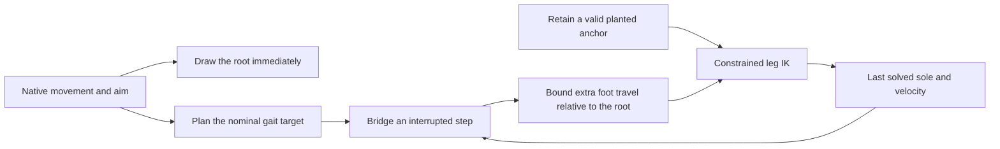
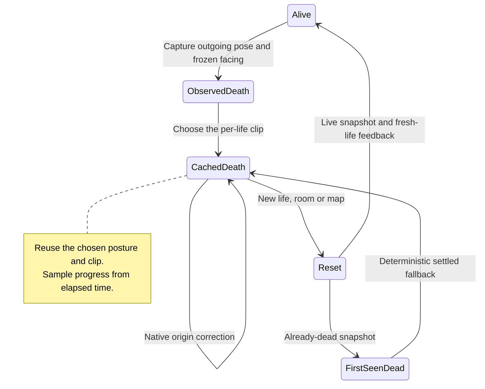

# Animation audit follow-up

The strict review of PR #2 at `9c005e1` found six remaining issues. They are
being corrected in order. A deployed build, a passing test and human acceptance
are recorded separately.

| Audit finding | Current status |
| --- | --- |
| F01: stop/restart foot discontinuity | Automated correction verified; human review and deployment pending |
| F02: reconstructed corpse changes pose | Automated correction verified; human review and deployment pending |
| F03: corpse intersects existing cover | Open |
| F04: airborne reconstruction restarts jump progress | Open |
| F05: quiet lateral walking lacks meaningful support coverage | Open |
| F06: CPU budget and sustained desktop/Android acceptance | Open |

The audit IDs above are separate from the requirement IDs in the
[completion ledger](hybrid-animation-requirements.md).

## F01: start a redirected step from the foot that was actually drawn

Previously, stopping could replace a swinging foot's position with its neutral
standing position. Restarting reused a frozen gait phase and could immediately
select a target halfway through a swing. A retained contact also became unsafe
when a later lift returned directly to the nominal path.

The correction keeps a reachable planted anchor. An interrupted swing starts
from the outgoing solved sole and its velocity, then joins the destination with
a finite 50 ms correction. Both the position and velocity corrections reach
zero at the endpoint. A stop settles at the outgoing foot's horizontal position.
The pelvis reach calculation includes an active recovery so that the IK solver
does not immediately undo it with a different target.
An interrupted handoff can use up to 8 units of pelvis correction, compared with
the existing 7-unit steady limit. This extra reach prevents the body braking pose
from forcing a near-limit outgoing sole to a new position. Its visual quality
still needs review together with the rest of the action.



Rapid reversals shrink and redirect the planned step through a 100 ms velocity
filter. They do not flip a full stride instantly across the body. This filter
only affects foot planning; it never filters player input, root position, camera
facing, shot timing or authoritative movement.

During an interruption, additional foot travel relative to the root has a speed
budget. The actual root displacement is preserved in full. The budget allows the
nominal walking swing to overtake the root, while preventing an instantaneous
replacement with a distant target. It is our presentation tuning, not a copied
Counter-Strike threshold. Ordinary uninterrupted cycles retain their existing
target paths.

The recovery uses an analytic velocity. If reach projection or the travel budget
changes its target, the outgoing velocity estimate removes the sampled root step
before adding native velocity. This prevents duplicate 64 Hz snapshots from
amplifying recovery momentum in a 120 Hz renderer. Standing contacts still have
zero world velocity.

## Verification

The [raw before/after evidence](acceptance/hybrid-animation/audit-f01-continuity.json.gz)
compares the frozen PR revision `9c005e1` with the corrected source. All 360
candidate cases pass the declared gates. The maximum constrained, post-skinning
zero-time residual is **0.221501 units**, below the 0.25-unit gate; this is not a
claim of mathematically identical rendered poses after every constraint.

| Check | PR revision `9c005e1` | Correction |
| --- | ---: | ---: |
| Cases exceeding the root-relative foot speed gate | 263 / 360 | 0 / 360 |
| Cases exceeding the zero-time position gate | 356 / 360 | 0 / 360 |
| Maximum zero-time sole displacement | 31.104684 units | 0.221501 units |
| Sustained stops ending without two feasible contacts | 0 | 0 |

The numerical gates were held constant while the implementation was revised.
The before/after results are fixed-step correctness evidence. They do not
measure input latency, physical GPU performance, Android thermals or human
acceptance.

The final correction also passes 99 JavaScript unit tests, the production build,
18 existing foot-shape/gait cases, 144 combat-composition cases, 12 lifecycle
cases and 48 ten-character locomotion fixtures. The latter include 30/60/120 Hz,
irregular timing, reduced motion and the six lab viewport sizes. They do not
replace actual-game input/resize and release verification after the remaining
findings are fixed.


The new browser regression uses the actual six skinned character models. It
advances native state at 64 Hz independently of render sampling, then measures
post-skinning sole centers. The full matrix contains 360 cases:

- Six characters, native quiet-walk and run speeds, forward and lateral movement.
- 30, 60, 64 and 120 Hz rendering, plus irregular frame times.
- Repeated four-tick move/release, repeated reversals and a sustained stop.
- Different warm-up lengths to interrupt different gait phases.
- Zero-time stop, restart and reversal probes, plus stable final support after a stop.

The speed gate measures motion after the first interruption; the zero-time
probes explicitly isolate stop, restart and reversal from ordinary travel.
Existing gait tests
separately check foot lift, toe angle, stance width and pelvis recovery. None of
these checks establishes artistic quality, meaningful quiet-walk support across
all actions, physical-device performance or perceived responsiveness. Those
acceptance items remain open.

```sh
node --test tests/botstrike-foot-recovery.test.mjs
node tests/botstrike-foot-continuity-browser.mjs
node tests/botstrike-foot-gait-browser.mjs
npm test
npm run build
```

Browser scripts accept `PLAYWRIGHT_ENTRY`, `CHROMIUM_PATH` and `ART_OUTPUT` for
local tool installations. `FOOT_CASES=smoke` runs the 24 native-rate stutter cases;
it does not replace the full matrix. Their fixed-step software-rendered timing
must not be presented as a hardware benchmark.

## Paired visual review

[Vector running stutter steps](assets/botstrike/continuity/vector-run.mp4) and
[Bastion quiet-walk stutter steps](assets/botstrike/continuity/bastion-walk.mp4)
show the same input and camera before and after the correction. The left side
uses PR revision `9c005e1`; the right side uses this correction. Both sides use identical model assets. The capture advances a 64 Hz native input fixture
with 32 Hz render samples; playback is slowed three times to expose the foot
handoffs. These short selected cases supplement the matrix and need human
review. They do not establish the quality of every gait or action.

To reproduce, prepare an unchanged checkout of `9c005e1` with its npm dependencies,
then run from the candidate repository:

```sh
MOTION_REFERENCE_WORKTREE=/path/to/reference-checkout node tools/capture-botstrike-foot-continuity.mjs
```

The capture checks the reference revision and rejects tracked modifications.
Its [manifest](assets/botstrike/continuity/capture.json) records both lab bundles
and model hashes. F03–F06 and broader human/device acceptance remain open.

## F02: preserve the same death across visibility returns

A corpse used to have two initialization paths. An observed death selected a
left, right or back fall, while reconstruction always selected a back fall.
Reconstruction could also restart an idle upper-body layer. A long frame gap
forced the animation to its final frame. These paths could move a settled head
by 67.55 units even though the native character had not moved.

The renderer now keeps a descriptor for the same death: life, map, chosen clip,
visual crouch posture, frozen facing, start time and outgoing pose. A visibility
return retains that presentation. The full-body clip samples elapsed time, so a
400 ms gap advances to the same point as continuous observation. It does not
restart or prematurely finish the collapse. A corpse uses one full-body action;
idle and upper-body layers cannot reappear underneath it.



The cosmetic fall uses a world height. If a corrected native snapshot changes
the corpse's origin height, the model offset compensates so the resting body
stays on the floor. The player snapshot, collision state, movement rules and
replay profile are untouched.

The [public-state projection](../botstrike-service/visibility.mjs) exposes no
per-player death timestamp for remote players. A first-ever observation of an
already-dead player therefore retains the existing settled fallback, now with
the same deterministic clip selector. This does not infer an unseen outgoing
pose or the visual crouch blend that existed before observation. Same-life
visibility returns reuse history that this actor actually observed.

### F02 checks

The [before/after evidence](acceptance/hybrid-animation/audit-f02-reconstruction.json.gz)
contains 168 cases and 1,200 repeated visibility invalidations. The matrix checks
all six rigs and all three fall variants, including
crouch entry/release, a visibility return during collapse, a 400 ms gap, a native
origin-height correction and legitimate room/map/life resets. Comparisons check
world joint positions, all bone rotations and local translations. Quaternion
comparison treats opposite signs as the same rotation.

| Case group | Cases | Before failures | After failures |
| --- | ---: | ---: | ---: |
| Settled visibility return | 72 | 72 | 0 |
| Visibility return during collapse | 12 | 12 | 0 |
| Long gap versus continuous observation | 12 | 12 | 0 |
| First-seen deterministic variant | 36 | 24 | 0 |
| Same-life native origin correction | 12 | 12 | 0 |
| Room/map reset and fresh-life firing | 12 | 12 | 0 |
| Repeated visibility returns, 100 per case | 12 | 12 | 0 |

The maximum joint shift across the continuity groups falls from **67.552346**
to **3.55 × 10⁻¹⁵ units**; the maximum bone-angle difference is
**5.96 × 10⁻⁸ radians**. The reset-group failures in the old revision concern
variant/reset consistency; fresh-life firing was already protected and remains
so.

The correction passes 100 JavaScript tests and the production build, plus 48
existing collapse/interruption cases, six airborne deaths, 96 posture cases,
144 combat-composition cases, 12 lifecycle cases, 48 ten-character locomotion
fixtures including reduced motion/six lab sizes, and the 24-case F01 native-rate
smoke check. These are software-rendered correctness results. They do not close
cover collision (F03), airborne living-character reconstruction (F04), artistic
acceptance or hardware budgets.

```sh
node tests/botstrike-death-reconstruction-browser.mjs
node tests/botstrike-posture-browser.mjs
node --test tests/botstrike-posture.test.mjs
```
