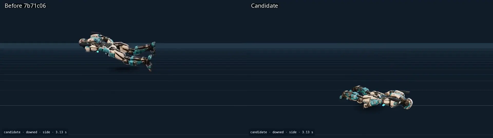

# Posture and collapse comparisons

Left: complete `7b71c06` character runtime and model tree. Right: the candidate. Each pair uses the same six-second fixture, camera and 30 fps fixed-step rendering. Capture manifests and SHA-256 fingerprints accompany the files. These are pose comparisons, not timing measurements.

- [Crouch and stand](crouch-cycle.mp4): moving crouch, firing, standing and repeated crouch changes.
- [Jump and land](jump-cycle.mp4): native-scale jump trajectory, airborne crouch/release, fire/reload and touchdown.
- [Collapse and respawn](downed.mp4): crouched airborne death, continued dead-player aim input and fresh-life firing. Corpse position/facing and ground support are visual checks; the player snapshot stays unchanged.
- [First-person crouch](crouch-cycle-first-person.mp4) and [first-person jump](jump-cycle-first-person.mp4): candidate viewmodel timing, using the game's native eye heights and shared visual crouch fraction.

The lab offers all six characters, all twelve weapons and front/side/back/feet views. Numerical coverage includes all three fall directions plus interrupted crouch entry/exit. New human acceptance is still needed for the updated poses and control feel.
