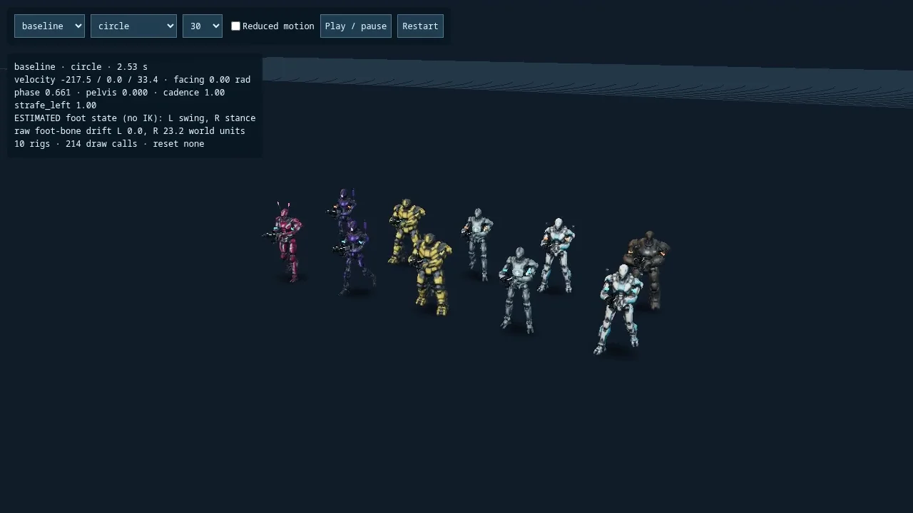
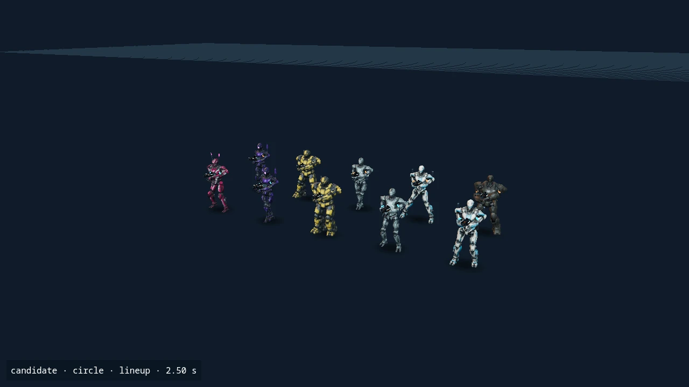

# Continuous locomotion: first hybrid-animation PR

This implements the first slice of the [hybrid animation proposal](hybrid-animation-proposal.md): a reproducible motion lab and continuous third-person directional blending using the existing six chassis and their existing clips. Native simulation, input, hit capsules, camera yaw/pitch, weapon timing and the Myelin application profile are unchanged. Myelin remains off-chain host replay verification.

## Runtime

`AnimationMotion` reads rendered player velocity and facing to produce local forward/sideways speed, acceleration, wrapped turn rate and grounded/crouch signals. It never writes to player state. Life/map changes, large positional corrections and update gaps reset its history. The scene also invalidates presentation when a room changes or an actor becomes hidden.

`LocomotionBlend` replaces the lower-body directional thresholds with continuous normalized weights. Idle fades into travel over 0–24 world units/second; forward walk blends into run over 145–245. Forward/backward/lateral contributions use local velocity. Crouching uses the existing crouch and crouch-walk clips; jump/fall are separate aerial targets. Pose weights approach their targets with a 70 ms exponential time constant, without delaying simulation or aiming.

All moving ground clips sample a single normalized gait phase using their actual loaded glTF durations. A deterministic per-life offset keeps actors out of lockstep. Cadence follows speed with the existing 0.6–1.6 bound. Jump/fall clocks start on entry and hold at the end rather than looping mid-flight. Full-body death, respawn and round-end actions fade the entire lower-body group. Upper-body events, reload grips and first-person locomotion retain their existing paths.

The pelvis receives a bounded yaw adjustment (at most 0.55 radians, smaller near lateral movement). Its direct spine child receives the exact inverse correction, preserving the upper body's blended orientation. These offsets are restored before the next mixer sample or lifecycle reset, so they cannot accumulate. Reduced motion disables this procedural yaw. The root/capsule transform remains authoritative.

This phase adjusts cadence, not spatial stride length. It introduces no foot constraints, leg IK, inertialisation, additional clips or chassis-specific movement rules.

## Reproduce an A/B comparison

```sh
npm ci
npm run dev:motion
# Open http://127.0.0.1:4173
```

The development server binds only to localhost and is not copied into `dist`. Its viewport contains ten robots spanning all six chassis, a fixed follow camera, baseline/candidate selection, 30/60/120 fps, reduced motion and repeatable sequences. Switching modes restarts the same sequence. The baseline retains the old discrete lower-body selection; it shares the current upper-body implementation and pose-restoration fix.

Fixtures cover starts/stops/reversal, circle-strafing, 90°/180° turns with firing, jump/landing/crouch, directional reloads, hit/equipment/death/respawn, and correction/map transitions. The HUD reports velocity, facing, normalized phase, active weights, yaw/cadence and **estimated** foot stance/swing with raw foot-bone drift. The estimate comes from gait phase; it is not a measured sole contact, collision query or active support constraint.

For deterministic six-second recordings with identical simulated times and camera, install Playwright and ffmpeg, then run:

```sh
ART_OUTPUT=/tmp/botstrike-motion MOTION_SCENARIO=circle node tools/capture-botstrike-motion.mjs
```

`PLAYWRIGHT_ENTRY` and `CHROMIUM_PATH` can point at an existing Playwright module and Chromium executable. The capture script renders fixed 1/30-second steps and encodes two MP4s; those recordings do not measure real-time frame pacing.

```sh
npm test
npm run test:host
npm run build
npm run test:motion-browser
node tests/botstrike-gait-browser.mjs
RELOAD_ONLY=1 node tests/botstrike-art.mjs
npm run test:botstrike-native # requires the existing matching native release pair
```

`motionLab.framePacing()` exposes the recent RAF interval p50/p95 during interactive playback. Collect it with ten visible rigs on representative physical desktop/mobile devices before setting a performance budget. The automated CPU measurement covers actor updates, root synchronization and event dispatch for ten rigs, excluding fixture construction, rendering, scene world-matrix updates, contact instrumentation and transform validation.

## Evidence and remaining work

See [recorded acceptance](acceptance/continuous-locomotion.json) for the exact local checks. Screenshots and recordings use the same fixtures, camera and time on both paths. The browser regression suite checks all seven sequences at 30/60/120 fps, jitter with reduced motion, all six required viewport sizes, finite normalized bone transforms, unchanged player inputs and repeatable resets. Existing run-ground, independent gait-phase, hit-reaction and reload-contact checks remain applicable.

| Discrete selection | Continuous blend |
| --- | --- |
|  |  |

Six-second fixed-step recordings: [baseline](assets/botstrike/locomotion/baseline-circle.mp4), [candidate](assets/botstrike/locomotion/candidate-circle.mp4). Both show ten rigs, the `circle` fixture, 30 fps and the same camera. The stills are extracted at the same video time. These are reproducible render captures, not recordings of a human match.

Visible defects in the source animation remain: lateral clips mostly reuse forward leg swing, there are no planted-foot constraints, and turns/stops have no bespoke braking or pivot clips. This first phase removes the discrete directional boundary; it does not establish that every transition is artistically better. Raw estimated stance drift in the circle fixture remains large on both paths and does not satisfy the proposal's provisional 2-world-unit contact-error target. Phase 2 must calibrate contact intervals against actual soles and add constrained foot IK before claiming that target.

Physical-device frame pacing, human A/B playtesting, input feel and detailed knee/weapon-clipping review remain open. Software Chromium timings are diagnostic samples, not hardware acceptance or an animation CPU budget. Keep this PR in draft until those checks are reviewed; later animation phases should be separate changes.
