# Crouching, jumping, landing and falling down

This follow-up belongs to PR #2. “Downed” uses the existing death state. Native movement, hit volumes, eye/shot origins, inputs and the signed replay profile retain their rules.

## Production references

| Released game | Public evidence reviewed | BotStrike decision |
| --- | --- | --- |
| [Counter-Strike 2 — Valve, April 24, 2026](https://www.counter-strike.net/newsentry/508485755865137963) | Valve adjusted airborne first-person crouch timing to better match third person, and smoothed foot IK transitions. | Use one crouch fraction for the body blend, foot planning and viewmodel placement, including in the air. The release notes do not expose Valve's animation graph or numerical transition settings. |
| [Uncharted 4 — Naughty Dog, GDC 2017](https://www.gdcvault.com/play/1024087/Physics-Animation-in-Uncharted-4) | Michal Mach's session overview describes an animation-driven physics layer that preserves responsiveness and artistic control. The overview was reviewed, not the complete talk or implementation. | Keep authored fall silhouettes and preserve the outgoing pose at death. F03 adds conservative clearance against existing map boxes; it remains an authored performance without articulated ragdoll dynamics. |

These precedents guide the separation between gameplay state, a readable pose and secondary motion. They do not establish equivalent implementation or visual quality.

## Defects and changes

**Crouch and stand.** The old body blend eased into crouch while the foot planner and first-person placement switched immediately. Upper-body lean was also lost when the authored clip was split into upper/lower layers. A shared 70 ms visual fraction now controls posture, foot stance/clearance and viewmodel placement. The native camera still uses its existing eye height, so aiming and collision retain their existing relationship.

**Jump and fall.** Airborne crouch blends toward the crouched lower-body pose in both views. F04 derives clip progress from the unchanged native jump references and preserves a validated same-flight blend through visibility/gap/correction returns. Native ticks distinguish a continuing flight from a later jump at the same speed; first sightings recover the current clip phase. Jump height and duration remain native simulation results. Foot locking and the upper-body landing cue share one ground predicate: low feet are still airborne while rising or more than 0.001 units above the floor. Landing compression follows the visual crouch fraction. See the [F04 evidence and limits](animation-audit-follow-up.md#f04-resume-the-observed-flight).

**Collapse and settle.** A crouched death previously rose roughly 19–20 world units before falling. Three new authored crouched-death variants retain folded knees until the torso falls. Their standing counterparts also have relaxed resting limbs; arms or knees must not prop the entire torso above the ground. A short snapshot blend preserves the actual outgoing solved pose, and weapons/contacts release with the existing death state.

Native dead players stop receiving gravity and retain their last position. The render model inherits bounded vertical motion using elapsed time. F03 adds clearance against existing map boxes, top support for deaths observed above cover, and a cosmetic turn along narrow passages. The observed rig yaw stays fixed; a passage can steer the model's fall orientation. The contact shadow follows the clearance offset/support surface. Player snapshots remain byte-for-byte unchanged by posing. See the [audit follow-up](animation-audit-follow-up.md#f03-give-an-authored-fall-room-to-fit) for limits and evidence.

**Respawn and interruptions.** A map/correction/reset could restore lower-body animation gain underneath a full-body corpse pose, pulling the corpse into the floor. Inactive resets now keep that layer disabled. Reconnecting reconstructs a settled pose, and new life clears corpse offsets while retaining fresh-life fire feedback.

```mermaid
stateDiagram-v2
    Grounded --> Airborne: Leave native ground
    Airborne --> Grounded: Native ground contact
    Grounded --> Collapsing: Death
    Airborne --> Collapsing: Death
    Collapsing --> Settled: Pose and cosmetic fall finish
    Settled --> Grounded: New life clears temporary state
    note right of Airborne
        Crouch blends in both views
        Foot locks stay released
    end note
```

## Review and evidence

The lab adds `crouch_cycle`, `jump_cycle` and `downed`. The first two include overlapping fire/reload and repeated crouch changes; the last includes airborne death, continued dead-player aim input and fresh-life firing. Side-view comparisons use the complete `7b71c06` client and model tree as the before version, with identical new fixtures and cameras in both versions. First-person lab placement now mirrors the game's crouch placement and native eye height; this corrects the harness for both versions.

See the [posture evidence](acceptance/hybrid-animation/posture-transitions.json) for real-rig measurements, failed intermediate checks, asset hashes, deterministic exports and game-browser validation. Mesh topology, skin weights and textures remain unchanged; the six editable rigs now contain 37 clips each.

Numeric gates include continuous crouch fractions across both views, no air foot locks, ground contact bounds, crouched-death head rise, grounded resting torsos, corpse facing, interruption recovery and fresh-life fire. They complement the existing all-weapon composition and walk/run checks. Fixed-step videos establish pose behavior; they do not establish FPS, Android thermal behavior or human acceptance of the new actions.

The last recorded browser deployment is `989a634`; newer audit corrections await release. The [release record](acceptance/hybrid-animation/posture-deployment.json) contains its verification and rollback details. That short desktop run measured 1.1 ms animation CPU p95 against the old 1 ms reference. Under the [current policy](acceptance/hybrid-animation/performance-policy.json), tight timing references are advisory and dedicated sustained/Android profiling is deferred. Human functional/visual acceptance remains open. Head-rise measurements use the head joint; resting support uses actual torso mesh vertices.
