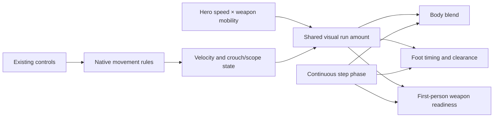

# Walking, running and changing between them

Reviewed on 2026-11-02. This is a presentation change: the native movement rules, input messages, shooting rules and signed replay profile are unchanged.

## What other games distinguish

Three decisions often get called “walk/run”: choosing a movement mode, displaying the resulting motion, and applying gameplay effects such as noise or accuracy. They need consistent behavior, but they are separate systems.

| Reference | What the public source establishes | Lesson for BotStrike |
| --- | --- | --- |
| [VALORANT controls — Riot Support](https://support.riotgames.com/en-us/valorant/gameplay/walking-running-and-crouching) | Players can choose default walk/run, rebind the alternate mode, and select hold or toggle behavior. Running is audible; walking/crouching serves stealth. | Make the control convention clear. BotStrike currently defaults to running, with hold-to-walk on Shift and analog movement on touch/gamepad. A configurable toggle is a separate accessibility improvement, not part of this animation patch. |
| [Valve Source SDK multiplayer animation](https://github.com/ValveSoftware/source-sdk-2013/blob/master/src/game/shared/Multiplayer/multiplayer_animstate.cpp) | `HandleMoving` in this TF-oriented implementation selects run while moving; `CalcMovementPlaybackRate` divides actual horizontal speed by the current sequence ground speed. | A game's control convention and its playback-rate calculation need not be the same decision. Match the animation to displacement. This public code is not CS:GO's proprietary animation implementation. |
| [Fortnite UEFN v28.30 — Epic](https://www.fortnite.com/news/fortnite-ecosystem-v28-30?lang=en-US) | Custom NPC movement exposes separate walk/run maximum speeds and acceleration/deceleration. | Treat speed ranges as data. This is a documented UEFN NPC feature, not evidence of Battle Royale's internal animation graph. |
| [Locomotion Based Blending — Epic](https://dev.epicgames.com/documentation/unreal-engine/locomotion-based-blending-in-unreal-engine?lang=en-US) | A technical sample blends walk/jog poses by speed and direction; a held key changes the movement component's maximum speed. | Blend compatible poses after simulation chooses motion. This is an engine sample, not a shipped-game case study. |

Riot's [0.50 patch notes](https://playvalorant.com/en-gb/news/game-updates/valorant-patch-notes-0-50/) also distinguish run-to-stop shooting accuracy from walking accuracy. Those accuracy thresholds must not be copied into an animation blend. Valve's [CS:GO Reanimated announcement](https://blog.counter-strike.net/2015/09/12492/) establishes an animation/readability overhaul; it does not publish exact gait thresholds.

The comparison above comes from official documentation and public code. It is not a claim that the proprietary animation graphs were inspected or that gameplay footage was measured frame by frame.

## The BotStrike mismatch

The third-person blend, foot timing and first-person animation previously used different absolute speed thresholds. That produced contradictory results across characters and weapons:

| Example | Native speed in game units/second | Old presentation problem | New behavior |
| --- | ---: | --- | --- |
| Vector quietly walking with a normal-mobility weapon | 305 × 0.55 = 167.75 | Already entering the third-person run blend | Walking pose, low foot lift and walking weapon readiness |
| Bastion running with Kraken | 210 × 0.82 = 172.2 | Below the first-person hard run threshold of 180 | Running pose and running readiness response |

The browser now reads the existing hero speed and weapon mobility, then compares horizontal velocity with that range. Quiet walking reaches 55% of the normal range under the existing native rules. Our visual blend starts at 60% and reaches full run at 90%; these are BotStrike tuning values, not values taken from another game.

Walk/run weights blend over the existing 70 ms response; the normalized step phase continues instead of restarting at a clip boundary. Both views use the same stride planner. First person evaluates the root/hips tracks it needs, while leaving invisible leg tracks out of its lower-body clips. Third person retains the leg solver and ground contacts.

Walking keeps low clearance; running allows more lift and less support time. The lateral support duration is also bounded by available leg travel so a minimum cycle time cannot force a planted foot outside its reachable range.

## Limits and review

Snapshots do not contain the held walk input. This mapping infers visual gait from velocity and the available crouch/scope state; it cannot distinguish quiet walking from partial analog movement at the same velocity. It does not control footstep audio or weapon accuracy. Backpedal and strafe retain their existing directional clips, with shared cadence/clearance rather than newly authored directional run clips.

Use `npm run dev:motion`, select `walk_run`, choose a character/weapon, then compare Front, Side and First person. The repeating six-second sequence is idle → walk → run → walk → stop, using each rig's native speed range. The original main baseline remains available for comparison.

Automated evidence is recorded in [walk-run evidence](acceptance/hybrid-animation/walk-run-transitions.json). Numeric phase/contact checks do not replace human judgment of weight, weapon clipping or control feel. The earlier human acceptance of the three reported walking defects applies to the earlier reviewed build; the new transition behavior has separate visual captures and still needs human playtesting.
